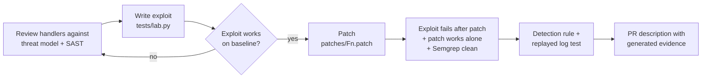

# payloop-vuln-lab: find it, fix it, detect it

A hands-on application-security case study on **PayLoop**, a fictional mobile-money wallet API (PHP 8 + SQLite). It contains
nine realistic vulnerabilities, a scripted exploit for each, one reviewable patch per finding, and the Wazuh detections that would
have caught the attack. Everything is synthetic; nothing here comes from a real system.

> Every claim in this repository is backed by a command you can run. `make all` is the proof.



## Run it (2 minutes, needs PHP 8.1+ with pdo_sqlite, Python 3.10+, `pip install pyyaml semgrep`)
```bash
make baseline   # all 9 exploits succeed on app/
make fixed      # all 9 fail on app + patches
make matrix     # each patch alone closes its own finding
make ssrf       # SSRF guard bypass tests (IPv4-mapped IPv6, rebinding-style DNS, encodings...)
make sast       # Semgrep flags the baseline, clean on the fix
make detect     # lint rules + 21-case detection regression suite
make docs       # regenerate findings/FINDINGS.md and pull-requests/*.md with live evidence
```

## The nine findings
| ID | Severity | Finding | Found by | Detection |
|---|---|---|---|---|
| F1 | Critical | SQL injection in statement search | SAST + review | 110120 |
| F6 | Critical | Hard-coded token signing secret | SAST + review | 110160/61, 110170 (limited) |
| F2 | High | IDOR on wallet lookup | review (logic) | 110140/41 |
| F3 | High | Path traversal in receipt download | SAST + review | 110121/22 |
| F4 | High | SSRF in partner webhook test | SAST + review | 110130/31/32 |
| F8 | High | Transfer integrity: negative amount, overdraft, replay | review (business logic) | 110150/51/52/53 |
| F5 | Medium | Unsalted MD5 password storage | SAST | none (static) |
| F7 | Medium | No login throttling, user enumeration | review | 110101/03/11/12/13 |
| F9 | Low | Stack traces returned to clients | SAST | 110123/24/80 |

Full write-up with reproduction steps and live before/after evidence: [`findings/FINDINGS.md`](findings/FINDINGS.md).
Per-finding PR descriptions: [`pull-requests/`](pull-requests). Operational follow-ups a patch cannot do: [`docs/REMEDIATION-NOTES.md`](docs/REMEDIATION-NOTES.md).

## Layout
```
app/                 vulnerable baseline (the "main" branch of the story)
patches/             one independent patch per finding (apply in any order)
tests/lab.py         boots an app on a throwaway DB, runs the exploit per finding, prints VULNERABLE / MITIGATED
tests/patch_matrix.py   proves each patch works on its own
tests/ssrf_guard_test.php   bypass-oriented unit tests
semgrep/             custom SAST rules (taint mode) with CWE/OWASP metadata
detections/wazuh/    Wazuh rules for the app's JSON log
tests/detections.yml + samples/   regression suite incl. false-positive controls and captured logs from the lab
tools/ruletest.py    offline lint + replay for the rules (see its docstring for limits)
findings/ pull-requests/   generated reports
scripts/make-pr-branches.sh   turns patches into PR-style branches in your own repo
```

## Things worth knowing
- **Honest limits.** SAST catches 6 of the 9 flaws. IDOR, throttling and transfer logic need review and runtime tests; the report says so.
- **The test loop caught defects in the fixes themselves** during development: a patch that silently depended on another
  (caught by `patch_matrix`), a Wazuh rule that never fired because a sibling rule matched first, and an SSRF filter bypass through
  IPv4-mapped IPv6 (caught by the guard tests). That is the argument for keeping exploits and detections as executable tests.
- **Detection is not prevention.** Rule 110150 fires after money moved on the baseline. The fixes are the control; the rules are the net.
- **Wazuh rules are simulator-verified, not engine-verified.** Follow [`docs/WAZUH-VALIDATION.md`](docs/WAZUH-VALIDATION.md) on a real manager before relying on them.

## Interview walk-through (about 8 minutes)
1. `make baseline`: show the nine exploits succeeding. Explain one end to end (F1 or F8).
2. Open `pull-requests/F8-*.md`: root cause, fix, generated evidence, the AI-assistance note.
3. `make matrix` and `make fixed`: proof, not claims.
4. Show a Wazuh rule and its test case in `tests/detections.yml`, then the false-positive controls.
5. Close on limits: what static analysis missed and what the rules cannot prevent.

See [`docs/AI-ASSISTED-WORKFLOW.md`](docs/AI-ASSISTED-WORKFLOW.md) for how to talk about AI use.
